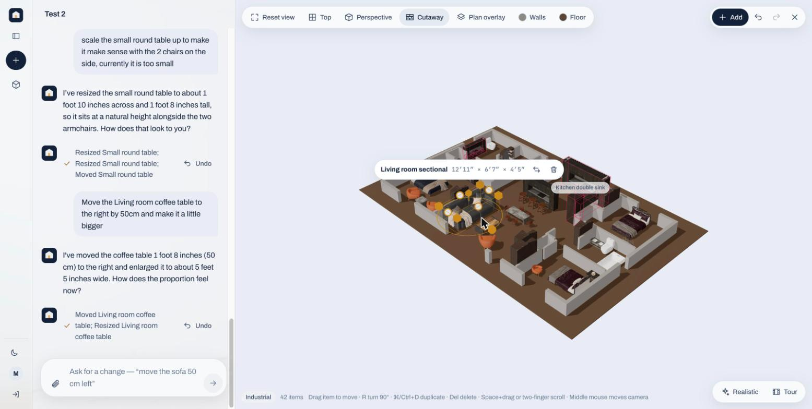
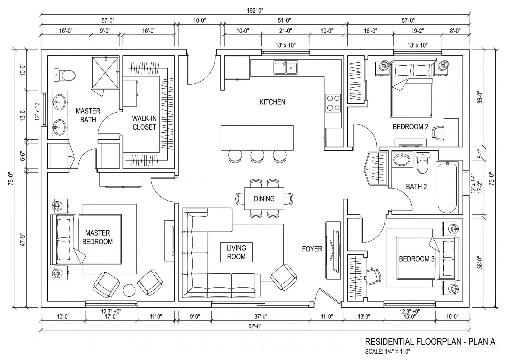
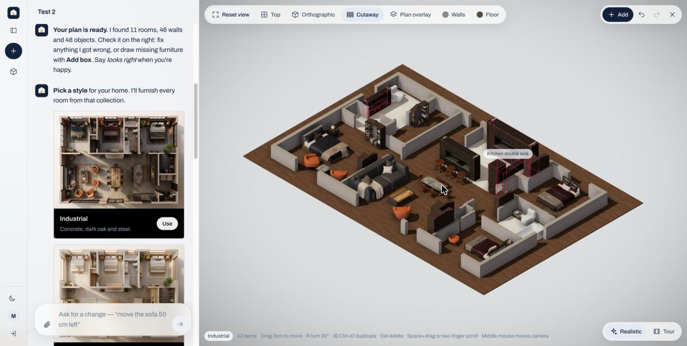
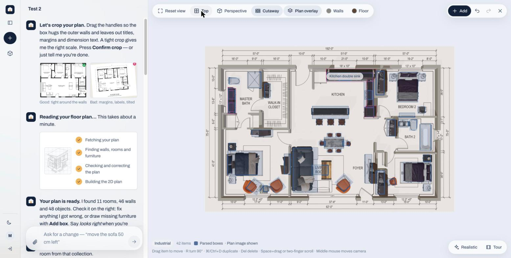
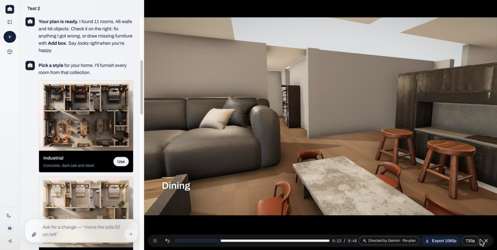
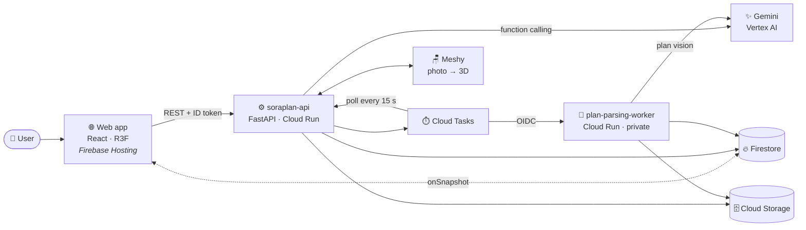

<div align="center">

# 🏠 SoraPlan

### Turn a floor-plan sketch into a real-scale, furnished 3D home — just by chatting.

[](https://soraplan.web.app)


<br/>



</div>

---

## ✨ What is SoraPlan?

Buying furniture or planning a renovation usually means guessing: *will this sofa fit? will the room feel cramped?*
SoraPlan answers that before you spend anything.

Upload a sketch, photo, or PDF of a floor plan. **Gemini** reads the walls, doors, rooms, and dimension labels and
builds a scene measured in real meters, then furnishes it in the style you choose. From there you just **talk**:
*"move the coffee table 50 cm to the right and make it a bit bigger"* — and the 3D home updates live.

<table>
<tr>
<td width="33%" align="center"><b>1 · Upload a plan</b></td>
<td width="33%" align="center"><b>2 · Pick a style</b></td>
<td width="33%" align="center"><b>3 · Explore &amp; edit in 3D</b></td>
</tr>
<tr>
<td></td>
<td></td>
<td></td>
</tr>
</table>

## 🚀 Features

| | Feature | Description |
|---|---|---|
| 📐 | **Plan → 3D in about a minute** | Gemini parses rooms, walls, doors and furniture with real dimensions from a sketch, photo or PDF |
| 💬 | **Chat-first editing** | Plain-language requests become precise scene edits through Gemini function calling, each one undoable |
| 🛋️ | **Auto-furnishing** | Detected objects are matched to a curated Japandi / Industrial catalog and fitted to their boxes |
| 📸 | **Your furniture, in 3D** | Upload a photo of a real piece; Meshy turns it into a GLB, scaled and placed in your plan |
| 📏 | **Real measurements** | Drag, rotate and resize with live dimensions (metric or imperial) and fit checks |
| 🧭 | **Many ways to look** | Top, perspective, cutaway and plan-overlay views, plus a realistic lighting mode |
| 🎬 | **AI-directed tours** | Gemini plans a cinematic walkthrough you can export as a 1080p video, right in the browser |
| ⚡ | **Live everywhere** | Firestore listeners push every change from the AI straight to the screen — no refresh |

<table>
<tr>
<td width="60%"></td>
<td width="40%"></td>
</tr>
<tr>
<td align="center"><sub>🎬 AI-directed walkthrough tour</sub></td>
<td align="center"><sub>📸 Photo → 3D model with Meshy</sub></td>
</tr>
</table>

## 🧠 How it uses Google Cloud

| Service | Role in SoraPlan |
|---|---|
|  **Gemini** | `gemini-4-argon` reads floor plans into structured JSON; `gemini-3.8-flash` runs the chat with function calling and directs the tours; `gemini-3.1-flash-image` makes project thumbnails |
|  **Cloud Run** | `soraplan-api` (public FastAPI: orchestrator, asset mapping, scene builder, tour planner) and a private plan-parsing worker. Both scale to zero |
|  **Cloud Tasks** | Triggers the parsing worker, and wakes the API every 15 s to poll Meshy while a 3D model is generated |
|  **Firestore** | Projects, floor plans, furniture mapping, scenes and chat history. The browser reads through `onSnapshot` with read-only rules; all writes go through the API |
|  **Firebase** | Hosting for the web app and Auth for sign-in |
|  **Cloud Storage · Secret Manager** | Plans, photos and GLBs in buckets; API keys in Secret Manager, never in the code |

## 🏗️ Architecture



**Flow:** the user uploads a plan → the API queues a Cloud Task → the private worker parses it with Gemini and writes the
result to Firestore → the browser sees it instantly. Every chat turn goes to the orchestrator, which calls Gemini with tools
such as `move_item`, `resize_item`, `replace_item` or `set_wall_color`, applies the edits, and writes the new scene back to Firestore.

## 🧰 Tech stack

| Layer | Tech |
|---|---|
| **Frontend** | Vite · React 18 · TypeScript · React Three Fiber / drei · Zustand · mp4-muxer |
| **Backend** | Python 3.12 · FastAPI · Pydantic · google-genai · firebase-admin |
| **AI** | Gemini on Vertex AI · Meshy (image → 3D) · OpenAI image edit (background removal) |
| **Infra** | Cloud Run · Cloud Tasks · Firestore · Cloud Storage · Secret Manager · Firebase Hosting & Auth |
| **3D assets** | GLB with meshopt + WebP compression (≈ 0.5 MB each, down from 10–60 MB) |
| **Testing** | pytest · Vitest · Playwright |

## 📁 Repository layout

```
📦 SoraPlan
├── 🌐 web/                          Chat-first web app (Vite, React, R3F)
├── ⚙️ backend/
│   ├── api/                         REST API + Gemini orchestrator (Cloud Run, public)
│   └── plan_parsing_worker/         Floor-plan parser (Cloud Run, private)
├── 🚀 deploy/                       setup.sh · upload_catalog.sh · deploy.sh
├── 🛠️ scripts/                      Catalog optimize/measure, asset migration
├── 🖼️ samples/                      Example floor plans and furniture photos
├── 📚 docs/                         Architecture, data model, AI pipeline, roadmap
└── 🔒 firestore.rules               Read-only rules for the browser
```

## 🏁 Getting started

### Prerequisites

- Node.js 20+ and Python 3.12
- A Google Cloud project with Vertex AI, Firestore and Cloud Storage enabled
- `gcloud` CLI and `firebase` CLI

### Run locally

```bash
# 1) API — http://localhost:8000
cd backend/api && cp .env.example .env            # fill in keys
python -m venv .venv && .venv/bin/pip install -r requirements.txt
gcloud auth application-default login             # Gemini through Vertex AI
.venv/bin/uvicorn app.main:app --reload --port 8000

# 2) Plan-parsing worker — http://localhost:8001
cd backend/plan_parsing_worker && cp .env.example .env
python -m venv .venv && .venv/bin/pip install -r requirements.txt
.venv/bin/uvicorn app.main:app --reload --port 8001

# 3) Web — http://localhost:5173
cd web && cp .env.example .env.local              # VITE_FIREBASE_API_KEY = FIREBASE_WEB_API_KEY
npm install && npm run dev
```

> [!NOTE]
> Locally, Meshy progress is polled by a background thread instead of Cloud Tasks, so no queue is needed.

> [!IMPORTANT]
> Credentials live only in the gitignored `.env` files and `backend/api/.secrets/`. On Cloud Run they come from
> Secret Manager and the service accounts' own identity.

### 🧪 Tests

```bash
cd backend/api && .venv/bin/pytest      # backend
cd web && npm test                      # web unit tests (Vitest)
cd web && npm run e2e                   # end-to-end (Playwright)
```

## ☁️ Deploy

Project `soraplan`, gcloud configuration `trungtin`:

```bash
deploy/setup.sh                       # once: APIs, service accounts, IAM, secrets, queues, buckets
scripts/optimize_catalog.sh           # once per catalog change: web-optimized GLBs
deploy/upload_catalog.sh              # sync assets to gs://soraplan-catalog
deploy/deploy.sh all                  # worker → api → Firestore rules → web
backend/api/.venv/bin/python scripts/migrate_assets.py --apply   # once: seed assets/ in Firestore
```

`firebase login` is needed once for the rules and Hosting steps. 3D files are never committed to git; the catalog lives in
`gs://soraplan-catalog`.

## 📚 Documentation

| Doc | Topic |
|---|---|
| [`GEMINI.md`](GEMINI.md) | High-level design and repo conventions |
| [`docs/02-architecture.md`](docs/02-architecture.md) | System architecture and cost model |
| [`docs/03-data-model.md`](docs/03-data-model.md) | Firestore data model |
| [`docs/04-ai-pipeline.md`](docs/04-ai-pipeline.md) | Gemini pipeline and prompts |
| [`docs/07-3d-asset-pipeline.md`](docs/07-3d-asset-pipeline.md) | 3D asset optimization |
| [`docs/10-chat-refactor-plan.md`](docs/10-chat-refactor-plan.md) | The chat-first app that runs today |

## 👥 Team

<table>
<tr>
<td align="center"><a href="https://github.com/minhanh29"><b>Minh Anh Nguyen</b></a><br/><sub>Team lead</sub></td>
<td align="center"><a href="https://github.com/ttin1412"><b>Trung Tin Phan</b></a></td>
</tr>
</table>

<div align="center">
<br/>
<sub>Built with ❤️ for the <b>AI Builder Cup</b> · Powered by Gemini, Cloud Run and Firebase</sub>
</div>
